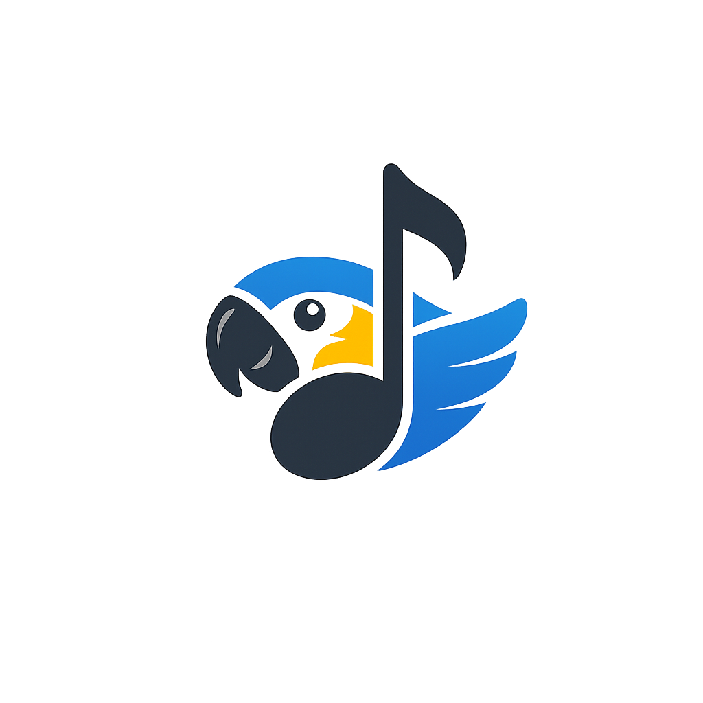

<div align="center">

</div>

# CanindeChords

[](https://github.com/GabFrank/caninde-chords/actions/workflows/deploy.yml)
[](https://franco-control.web.app)

Gestor colaborativo de canciones, acordes y setlists para músicos, con
sincronización en tiempo real (Modo Director), un **Soundpad** para disparar
sonidos en vivo durante sesiones y ceremonias, y **cambio de presets por MIDI**
en un pedal de efectos al abrir cada canción. Funciona **sin conexión**, que es
la situación normal en el lugar de la ceremonia. PWA construida con React + Vite
+ Firebase.

> **Plataforma propia (v2):** la app ya no depende de Google AI Studio. Se
> versiona y publica automáticamente desde GitHub a Firebase Hosting en cada
> cambio en `main`. Ver **[DEPLOY.md](DEPLOY.md)**.

## Arranque rápido

**Requisitos:** Node.js 22+

```bash
npm install
npm run dev      # http://localhost:3000
```

### Pruebas

```bash
npm run lint                      # tsc --noEmit
npm test                          # vitest sobre la lógica pura
npm run build && npm run smoke    # interfaz en cuatro viewports
npm run build && npm run soundpad # el Soundpad en un navegador, sin red
npm run build && npm run offline  # guardar sin red no traba la app
npm run build && npm run midiout  # pedal de efectos fingido
```

El `npm run build` no es opcional: las pruebas de navegador sirven `dist/`, y
sin compilar medirían el build anterior. Hay una guarda que corta la prueba si
`dist/` quedó atrás.

No hace falta configurar variables de entorno: la configuración de Firebase es
pública y vive en `firebase-applet-config.json`.

## Publicación

La app se publica automáticamente en **Firebase Hosting** al hacer push a `main`
(vía GitHub Actions). La configuración completa de desarrollo y deploy está en
**[DEPLOY.md](DEPLOY.md)**.

URL pública: https://franco-control.web.app

## Documentación

- **[DEPLOY.md](DEPLOY.md)** — infraestructura, publicación, caché y base de datos.
- **[AUTH.md](AUTH.md)** — cómo funciona el acceso con Google y cómo depurarlo.
- **[AGENTS.md](AGENTS.md)** — arquitectura, reglas de negocio y workflows.
- **[docs/SOUNDPAD.md](docs/SOUNDPAD.md)** — el Soundpad: modelo de datos, gotchas y cómo publicarlo.
- **[docs/MIDI-PEDAL.md](docs/MIDI-PEDAL.md)** — el pedal de efectos por MIDI: cómo se conecta, dónde funciona y por qué la app no corrige la numeración del fabricante.
- **[docs/OFFLINE.md](docs/OFFLINE.md)** — guardar sin red: por qué una escritura de Firestore nunca resuelve offline y cómo se maneja.
- **[TODO.md](TODO.md)** — backlog de mejoras.
